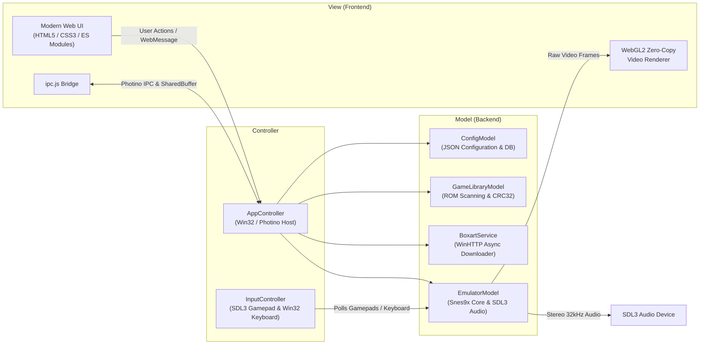

# Snex9x v2 — Modern Super Nintendo Entertainment System Emulator

[](https://microsoft.com/windows)
[](https://isocpp.org/)
[](https://tryphotino.io)
[](https://libsdl.org)
[](LICENSE.md)
[](SECURITY.md)

**Snex9x v2** is a high-performance Super Nintendo Entertainment System (SNES / Super Famicom) emulator designed with a modern **Model-View-Controller (MVC)** software architecture. It combines a robust **C++17** backend powered by the beloved **Snes9x** emulation core and **SDL3** with a sleek, GPU-accelerated **Web frontend** running inside **Photino.Native (Microsoft WebView2)**.

Through a zero-copy shared memory video pipeline, Snex9x v2 delivers pixel-perfect 60 FPS emulation rendered with hardware-accelerated WebGL2 shaders (including CRT scanlines, aperture grille, and curvature), CPU upscaling filters (xBRZ 2x, EPX, HQ2X, 2xSaI, Blargg NTSC), full 4-player multitap support, complete gamepad-driven library navigation, and an integrated offline database of 4,200+ SNES games with automatic boxart thumbnail downloading.

---

## Table of Contents

- [Key Features](#key-features)
- [Architecture & Tech Stack](#architecture--tech-stack)
- [Project Directory Structure](#project-directory-structure)
- [System Requirements & Prerequisites](#system-requirements--prerequisites)
- [Compilation & Build Guide](#compilation--build-guide)
- [Default Controls & Hotkeys](#default-controls--hotkeys)
- [Third-Party Libraries & Licensing](#third-party-libraries--licensing)
- [Security Policy](#security-policy)

---

## Key Features

### 🎮 Accurate Emulation Core
- Built on top of the **Snes9x** core, ensuring high compatibility with commercial games and homebrew.
- Full support for SNES enhancement co-processors: **SuperFX (GSU-1/2)**, **SA-1**, **DSP-1/2/3/4**, **S-DD1**, **OBC-1**, **ST010/ST011/ST018**, **Cx4**, **SPC7110**, and **S-RTC**.
- Cycle-accurate SPC700 audio DSP emulation with configurable audio interpolation (Gaussian, Linear, Cubic, Sinc, None).
- Adjustable SuperFX overclocking (50% – 400%) and optional sprite flicker reduction.

### ⚡ Zero-Copy Video Pipeline & WebGL2 Shaders
- **Shared Memory IPC**: Frames generated by the Snes9x PPU are written to an inter-process shared memory buffer (`CreateSharedBuffer`) and streamed directly to Microsoft Edge WebView2 with sub-millisecond latency.
- **Hardware-Accelerated WebGL2 Renderer**: Smooth 60 FPS presentation with integer scaling, aspect-ratio correction (4:3, 8:7, Stretch), and bilinear filtering.
- **CRT Simulation Shader**: Custom scanlines synced to internal vertical resolution, subtle aperture grille vertical modulation, phosphor subpixel chroma shift, and corner vignette/curvature.
- **CPU Texture Filters**: Real-time multi-threaded **xBRZ 2x** scaling, **EPX**, **2xSaI**, **Super 2xSaI**, **HQ2X**, and **Blargg NTSC** (Composite, S-Video, RGB) video presets.

### 🕹️ SDL3 Gamepad Engine & 4-Player Multitap
- **4-Player Simultaneous Support**: Connect up to 4 controllers with independent device assignment (Keyboard, PlayStation DualShock 4 / DualSense, Xbox Series/One/360, and generic DirectInput/XInput/HID gamepads).
- **Super Multitap Emulation**: Automatic or manual Super Multitap (MP5) mode for 4-player party games like *Super Bomberman*, *Micro Machines*, and *Secret of Mana*.
- **Interactive Rebinding & Haptics**: In-app controller binding modal with visual SNES joypad layout and instant rumble/vibration tests.
- **Gamepad-Driven UI Navigation**: Browse the entire game library from your couch using your controller's D-Pad or Left Analog stick (with smooth auto-repeat scrolling), launch games with the DualShock 4 **X** button (`button_south`), and toggle full-screen mode with **Square** (`button_west`) or **F11**.

### 📚 Game Library & Metadata Database
- **Offline 4,200+ Title Database**: Includes game title, No-Intro canonical name, release year, developer, publisher, genre, player count, and CRC32 hash.
- **Automatic ROM Identification**: Instantaneous CRC32 hash calculation with automatic detection and stripping of 512-byte SMC/copier backup headers.
- **Automated Boxart Downloader**: Asynchronously fetches and caches official boxart covers from the `libretro-thumbnails` repository over secure WinHTTP HTTPS, with multi-region fallback (`USA`, `Europe`, `Japan`, `World`) and Git symlink resolution.
- **Save States & SRAM**: 10 quick-save slots per game, external save state import/export (`.frz`, `.s01`..`.s10`), and battery-backed SRAM persistence (`.srm`).

---

## Architecture & Tech Stack

The application strictly implements the **Model-View-Controller (MVC)** pattern:



| Component | Technology | Role |
| :--- | :--- | :--- |
| **Backend Core** | C++17 (MSVC) | High-performance orchestration, memory management, and file I/O. |
| **Emulation Engine** | Snes9x (C/C++) | Accurate 65c816 CPU, SPC700 APU, PPU, and co-processor emulation. |
| **Window Host** | Photino.Native | Lightweight desktop window shell utilizing native Microsoft WebView2. |
| **Input & Audio** | SDL3 (64-bit) | Low-latency audio playback stream, gamepad event polling, and rumble. |
| **Video Display** | WebGL2 (GLSL 300 es) | Hardware-accelerated blit, texture filtering, and CRT scanline shader. |
| **Frontend UI** | HTML5 / CSS3 / Vanilla JS | Responsive interface, modal popovers, glassmorphism, and menubars. |
| **Data & Networking** | `nlohmann/json` & WinHTTP | JSON serialization, settings persistence, and HTTPS cover downloads. |

---

## Project Directory Structure

```
Snex9x_v2/
├── CMakeLists.txt              # Root CMake project build configuration
├── README.md                   # Project overview and technical documentation
├── LICENSE.md                  # Comprehensive MPL-2.0 and third-party licenses
├── SECURITY.md                 # Security policy and vulnerability disclosure
├── config/                     # Runtime application data & settings
│   ├── boxarts/                # Cached boxart cover images (.png)
│   ├── roms/                   # User ROM directory
│   ├── saves/                  # Battery SRAM (.srm) & Save States (.s01..s10)
│   ├── controls.json           # 4-player controller bindings & deadzones
│   ├── games_db.json           # 4,218 title SNES game database
│   ├── library.json            # User ROM library metadata & play history
│   └── settings.json           # Emulation & graphics configuration
├── external/                   # Vendored submodules & external libraries
│   ├── photino.Native/         # Photino.Native C++ desktop window wrapper
│   └── snes9x/                 # Snes9x emulator core source
├── src/                        # C++ source code (MVC Architecture)
│   ├── main.cpp                # Application entry point
│   ├── app.rc                  # Windows application icon & manifest resources
│   ├── model/                  # Model layer: core state, library, emulation
│   │   ├── ConfigModel.hpp / .cpp
│   │   ├── BoxartService.hpp / .cpp
│   │   ├── GameLibraryModel.hpp / .cpp
│   │   └── EmulatorModel.hpp / .cpp
│   └── controller/             # Controller layer: input & window orchestration
│       ├── InputController.hpp / .cpp
│       └── AppController.hpp / .cpp
└── ui/                         # Frontend View layer
    ├── index.html              # Main HTML5 layout & modal dialogs
    ├── icon.png                # Window and browser icon
    ├── styles/
    │   └── main.css            # Glassmorphism styling, animations & theme
    └── js/
        ├── app.js              # View controller, DOM listeners & menus
        ├── ipc.js              # WebView2 IPC & shared buffer bridge
        └── webgl-renderer.js   # WebGL2 zero-copy renderer & CRT shaders
```

---

## System Requirements & Prerequisites

### Minimum System Requirements
- **Operating System**: Windows 10 (version 1809 or later) or Windows 11 (64-bit).
- **Processor**: Intel Core i3 / AMD Ryzen 3 (Dual-Core 2.0 GHz or higher).
- **Memory**: 4 GB RAM.
- **Graphics**: GPU supporting OpenGL 3.0 / DirectX 11 / WebGL 2.0.
- **Runtime**: [Microsoft Edge WebView2 Runtime](https://developer.microsoft.com/en-us/microsoft-edge/webview2/) (pre-installed on most modern Windows systems).

### Build Prerequisites
To compile Snex9x v2 from source, ensure you have the following installed:
1. **Visual Studio 2022** (Community, Professional, or Enterprise):
   - Workload: **Desktop development with C++** (MSVC toolset v143, Windows 10/11 SDK).
2. **CMake**: Version 3.20 or newer (included with Visual Studio or available via `winget install Kitware.CMake`).
3. **Git**: Version 2.30 or newer.

---

## Compilation & Build Guide

### 1. Clone the Repository
Clone the repository and its vendored submodules:
```powershell
git clone --recurse-submodules https://github.com/YourUsername/Snex9x_v2.git
cd Snex9x_v2
```

*(If you already cloned without `--recurse-submodules`, initialize them with: `git submodule update --init --recursive`)*

### 2. Configure the CMake Project
Generate Visual Studio project files for x64:
```powershell
cmake -B build -S . -A x64
```

### 3. Build the Executable

#### Release Build (Recommended for optimal performance):
```powershell
cmake --build build --config Release
```
The compiled executable and required dependencies (`SDL3.dll`) will be output to:
`build\Release\Snex9x_v2.exe`

#### Debug Build (For development and debugging):
```powershell
cmake --build build --config Debug
```
The debug executable will be output to:
`build\Debug\Snex9x_v2.exe`

---

## Default Controls & Hotkeys

### Keyboard (Player 1 Default)

| SNES Joypad Button | Default Keyboard Key |
| :--- | :--- |
| **D-Pad Up / Down / Left / Right** | `Up` / `Down` / `Left` / `Right` Arrow Keys |
| **B Button** | `Z` |
| **A Button** | `X` |
| **Y Button** | `A` |
| **X Button** | `S` |
| **L Shoulder** | `Q` |
| **R Shoulder** | `W` |
| **Start** | `Enter` |
| **Select** | `Right Shift` |

### Gamepad UI Navigation & Shortcuts

| Action | Controller (DualShock 4 / Xbox) | Keyboard |
| :--- | :--- | :--- |
| **Navigate Game List** | `D-Pad Up / Down` or `Left Stick Up / Down` | `Up` / `Down` Arrow |
| **Page Scroll (Jump 10)** | `D-Pad Left / Right` or `L1 / R1` | `Page Up` / `Page Down` |
| **Launch Selected Game** | `X` (DualShock 4) / `A` (Xbox) | `Enter` |
| **Toggle Fullscreen** | `Square` (in Library view) | `F11` (anytime) |
| **Close Dialog / Modal** | `Circle` (DualShock 4) / `B` (Xbox) | `Escape` |
| **Pause / Resume** | — | `Space` |
| **Quick Save State** | — | `F5` |
| **Quick Load State** | — | `F7` |
| **Emulation Settings** | — | `F9` |
| **Graphics Settings** | — | `F10` |
| **Configure Controls** | — | `F12` |
| **Open ROM File** | — | `Ctrl + O` |
| **Scan ROM Directory** | — | `Ctrl + Shift + O` |
| **Search Database** | — | `Ctrl + D` |
| **Close Active ROM** | — | `Ctrl + W` |
| **Soft Reset** | — | `Ctrl + R` |
| **Hard Reset (Power Cycle)** | — | `Ctrl + Shift + R` |

---

## Third-Party Libraries & Licensing

### Snex9x v2 License
Snex9x v2 application code (located in `src/` and `ui/`) is licensed under the **Mozilla Public License Version 2.0 (MPL-2.0)**. For complete legal texts, see [LICENSE.md](LICENSE.md).

### Third-Party Components & Notice
This project incorporates several external libraries and assets, each governed by their respective licenses:

| Component | License | Details / Terms |
| :--- | :--- | :--- |
| **[Snes9x](https://github.com/snes9xgit/snes9x)** | Snes9x License | The Snes9x core is free for non-commercial personal use and redistribution. Commercial usage or monetization is strictly prohibited under the original Snes9x license. |
| **[Photino.Native](https://github.com/tryphotino/photino.Native)** | Apache License 2.0 | Desktop window wrapper around OS webview engines. |
| **[SDL3](https://github.com/libsdl-org/SDL)** | zlib License | Simple DirectMedia Layer for multi-platform gamepad handling and audio streaming. |
| **[nlohmann/json](https://github.com/nlohmann/json)** | MIT License | Modern C++ JSON parser and serializer. |
| **[xBRZ Scaler](https://sourceforge.net/projects/xbrz/)** | GNU General Public License v3 (GPL-3.0) | High-quality pixel art scaling filter by Zenju. |
| **snes_ntsc (Blargg)** | GNU LGPL v2.1+ | Accurate NTSC composite, S-Video, and RGB video artifact filter by Shay Green (Blargg). |
| **[Microsoft WebView2](https://developer.microsoft.com/en-us/microsoft-edge/webview2/)** | Microsoft Software License | WebView2 runtime loader library for hosting modern Chromium content on Windows. |
| **[libretro-thumbnails](https://github.com/libretro-thumbnails/libretro-thumbnails)** | Fair Use / Respective Copyright Holders | SNES game cover boxart images are the intellectual property of their original developers and publishers, fetched strictly for personal non-commercial reference. |
| **[GameDB-SNES](https://github.com/niemasd/GameDB-SNES)** | Public Domain / CC0 | SNES game database metadata compiled by Niema Moshiri. |

---

## Security Policy

For information regarding security vulnerability reporting, threat model boundaries, and disclosure policies, please consult [SECURITY.md](SECURITY.md).

---

*Super Nintendo Entertainment System (SNES) and Super Famicom are registered trademarks of Nintendo Co., Ltd. Snex9x v2 is not affiliated with, authorized, endorsed, or supported by Nintendo.*
